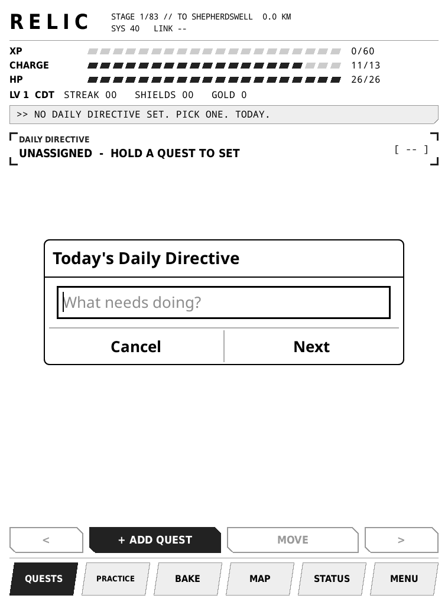
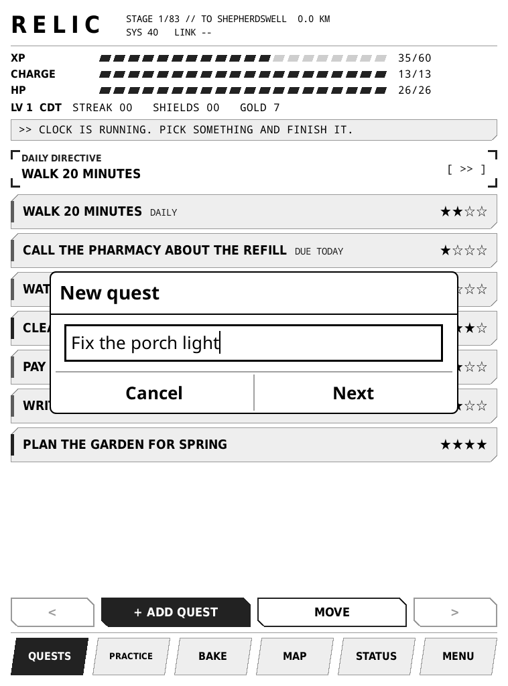
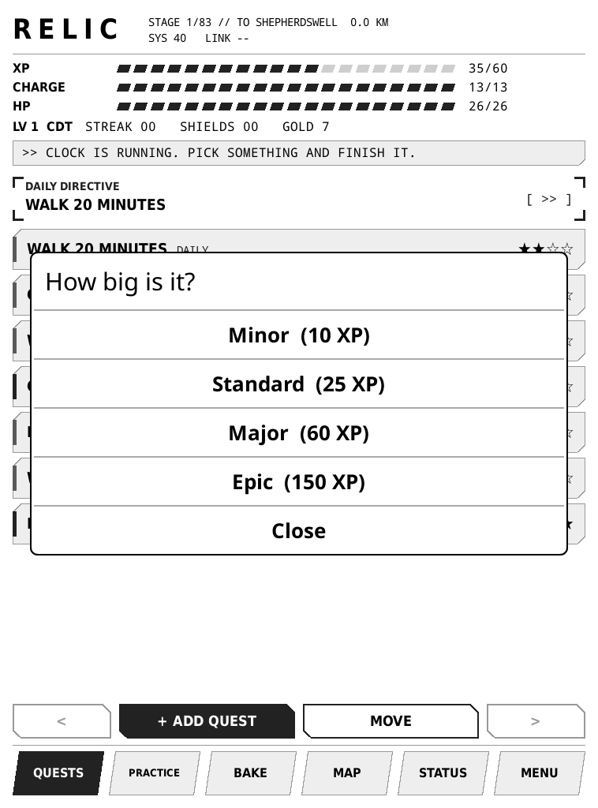
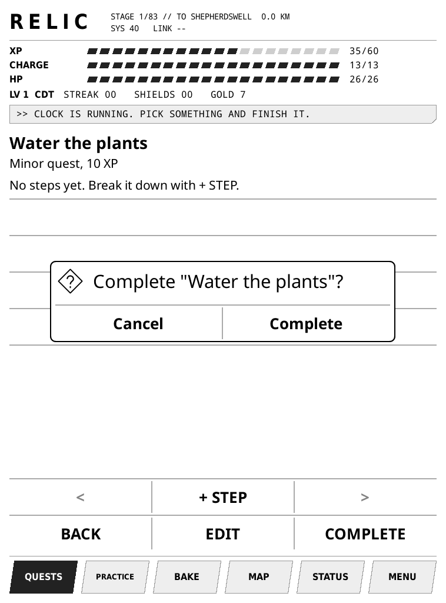
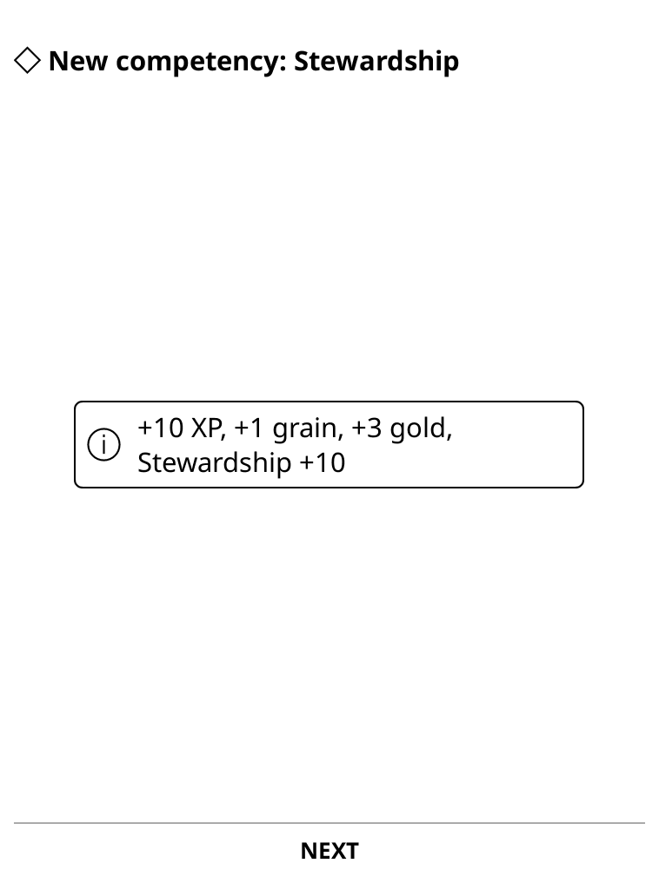
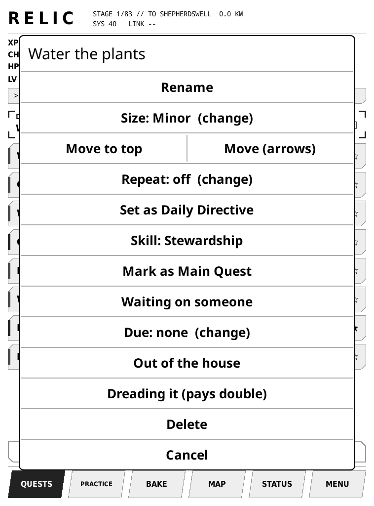
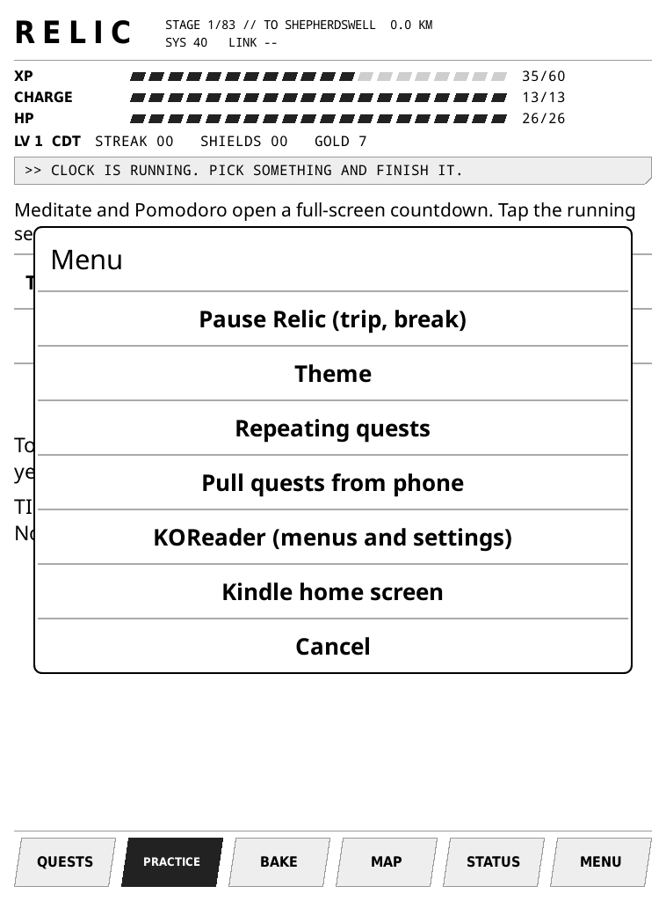

# How to play Relic

Relic is a to-do list that plays like a game. You write down things you want to get done. Each one is a **quest**. Finishing quests earns points and gold, and the game around them slowly opens up.

You only need four things: **add a quest, finish a quest, pick today's Directive, and check it off.** Everything else is optional.

## Turning it on

Press the button on the bottom edge of the Kindle. The lock screen shows today's quests; pressing the button again brings back the full list.

Relic opens by itself whenever the Kindle starts. If you ever land somewhere else, tap the top of the screen and choose **Tools > Relic > Open Relic**.

## 1. Pick today's Daily Directive

Each day, choose one quest that matters most. That's the **Daily Directive**. Finish it before midnight and your **streak** grows by one. Every 7 days in a row earns a **shield**, which covers one missed day.

Missing a day breaks the streak. After the first week, it also costs 15% **Integrity** (shown on STATUS). Finishing a Directive repairs 10%.

To set it: hold your finger on a quest for a second, then tap **Set as Daily Directive**.

## 2. Add a quest

Tap **+ ADD QUEST** at the bottom. A keyboard appears. Type what needs doing, then tap **Next**.

Pick how big it is. Bigger quests pay more.

- **Minor**: a few minutes (water the plants)
- **Standard**: a normal task (pay a bill)
- **Major**: an afternoon (clean out the garage)
- **Epic**: a project (plan the garden)

## 3. Finish a quest

Tap the quest, then tap **COMPLETE**, then **Complete** again to confirm.

You'll see what you earned. Sometimes a short scene or message follows. Tap **NEXT** or **CLOSE** to go on.

Big quest? Break it into steps: open it and tap **+ STEP** for each one. Tap a step to check it off.

## 4. Change or remove a quest

Hold your finger on any quest for a second. This menu opens:

The useful ones: **Rename**, **Size**, **Set as Daily Directive**, **Due** (a date), **Repeat** (for things you do every day or every week), and **Delete**.

## The other tabs

The row along the bottom: **QUESTS** is home. The rest are extras to explore when you feel like it:

- **PRACTICE**: timers for meditating or focused work
- **BAKE**: put two ingredients in a barrel and see what comes out
- **MAP**: a walk from Canterbury to Rome. It moves with steps counted on a phone (only if the phone sync was set up)
- **STATUS**: your level, rank, records, and **LOOT**
- **MENU**: theme, pause, and a way back to the regular Kindle

## Gold and loot

Finishing quests earns gold (shown at the top). Gold can't be spent in the game. It's for real rewards you choose yourself, like "New gardening gloves, $20". Rewards are added from a phone through Todoist (ask whoever set up the Kindle). They show under **STATUS > LOOT**. When you've earned enough, tap one to claim it, then treat yourself.

## Going away?

**MENU > Pause Relic** before a trip. Everything stops and the streak waits for you. Tap **RESUME** when you're back.

## Reading a book

**MENU > Kindle home screen** goes back to the normal Kindle. To come back, open KUAL and start KOReader.

## If something looks wrong

Take a photo of the screen and send it to whoever set up the Kindle. Your progress is saved on the device and isn't lost by restarting it.
