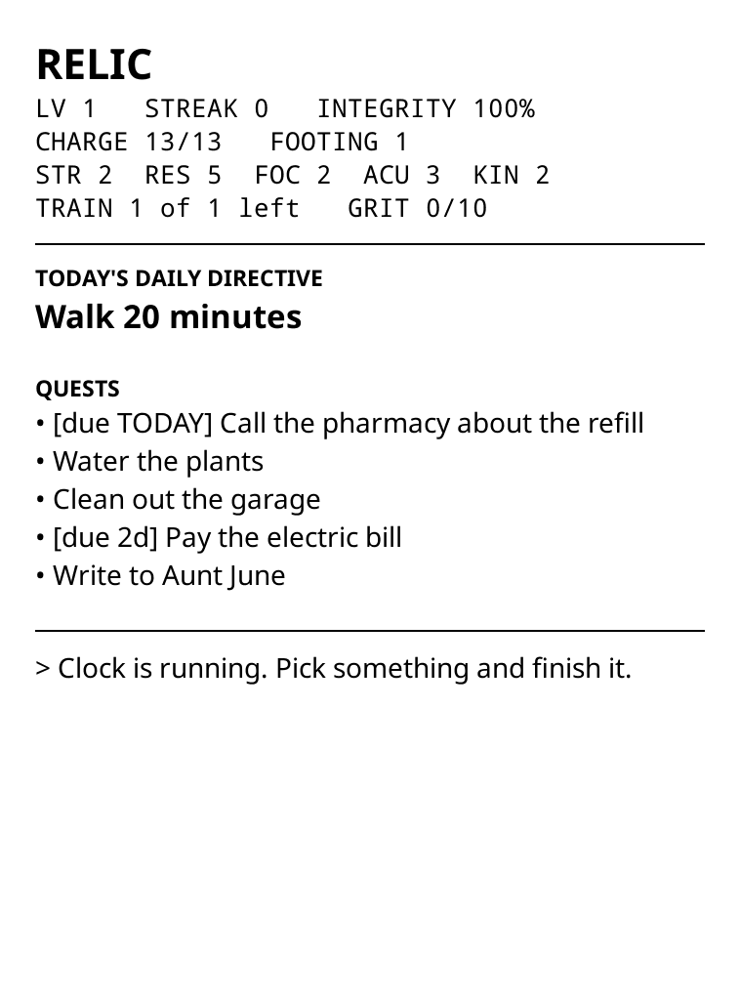
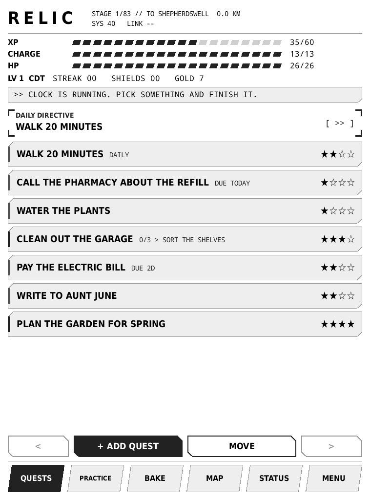
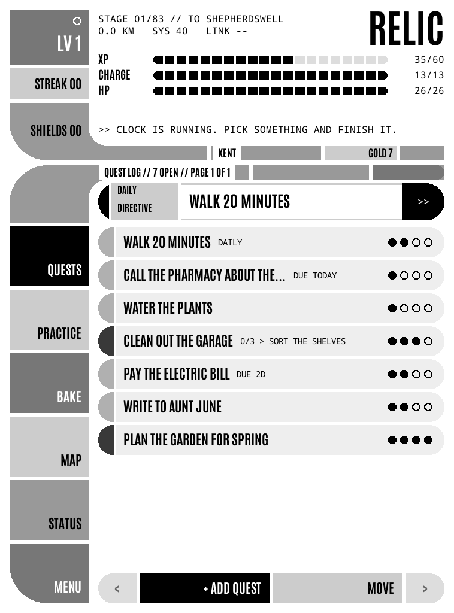
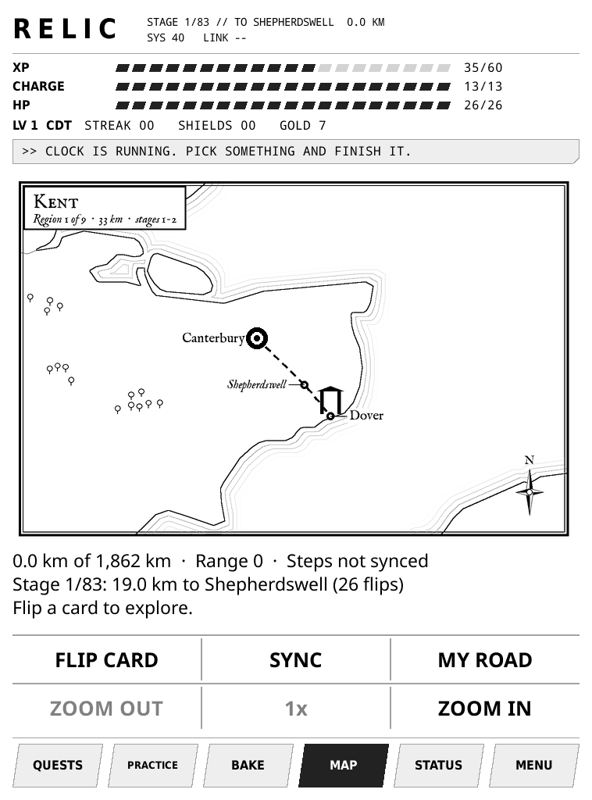

# Relic

Relic turns a jailbroken Kindle into a quest log that plays like a game. Your to-dos become quests. Finishing them earns XP, gold and ranks, and the game around them keeps going for months. It's a KOReader plugin and runs offline on e-ink.

| Lock screen | Quests (Console theme) | Quests (Beam Me Up theme) |
|---|---|---|
|  |  |  |

## What it does

**Your to-do list is the lock screen.** Every time the Kindle sleeps, it shows today's Daily Directive, your next five quests with due dates, your stats and a line from your companion. It replaces the Kindle's screensaver, Special Offers ads included. Glance at it on the way past and you know what's next.

**Quests that fit real life.** Four sizes (Minor, Standard, Major, Epic) pay more as they grow. Break big ones into checklists. Give them due dates, and late ones rise to the top. Make them repeat (every day, weekdays, every Monday and Friday, every 3 days); a missed one rolls over instead of piling up. Mark one "waiting on someone" or "out of the house", or flag it "dreading it" for double XP.

**One thing that matters, every day.** Pick a Daily Directive. Finish it and your streak grows; every 7 days earns a shield that covers a missed day. Skip it and your Integrity drops (after a first-week grace period).

**Gold that buys real things.** Quests pay gold by size. Gold can't be spent in the game: it goes toward rewards you set yourself ("Bandsaw $200"). Claim one when you've earned it, then go buy it with your own money.

**Levels, ranks and skills.** XP raises your level and stats. A 12-rank ladder runs from Cadet to Fleet Admiral, with a full-screen promotion each time. Skills appear on their own, based on the kind of things you finish.

**A walk to Rome.** The map is the Via Francigena, Canterbury to Rome: 83 real stages, 1,862 km, at real scale. Steps from your phone become Range; spend it to flip cards and explore. Along the way: fights, elite monsters, guardians that block the road until beaten, and gear drawn from 19th-century engravings.

**Baking.** Put two ingredients in a barrel and see what comes out. 46 recipes to find. Baked goods heal, repair Integrity, earn shields, boost XP and help in fights. Salvage, merge and regrow what you don't need.

**Practice.** Meditation timers, a Pomodoro timer with a time log per quest, and TRAIN: log pushups, squats or dumbbell sets to build Grit.

**Records.** A 14-day chart of quests done, a weekly summary (done, skipped, XP, gold), when in the day you get things done, your best day and best streak.

**A story that opens up as you go.** A companion rides along and comments on how you're doing. The story unfolds stage by stage along the road, and it notices when you skip days.

**Phone sync (optional).** With a free Todoist account, add quests from your phone (labels set size, Daily, deadlines, loot rewards; recurring tasks become repeating quests), send daily step counts with an included iPhone Shortcut, and get daily save backups and a monthly play history in your own Todoist.

**Built for real life.** Pause it for a trip and your streak waits. Two themes. It updates itself from this repo and can roll back. Everything works offline; the map and loot rewards need the phone sync.

Screenshots from the KOReader desktop emulator at Paperwhite 2 size. New to it? **[HOW-TO-PLAY.md](HOW-TO-PLAY.md)** covers the basics in five minutes.

## Quick install

Already running KOReader? Copy the `relic.koplugin` folder into `koreader/plugins/` on the Kindle and restart KOReader. Relic opens on its own.

Starting from a stock Kindle: **[SETUP.md](SETUP.md)** covers the jailbreak, KOReader, Relic and the optional phone sync.

## Status

Version 42. A personal project, shared with friends. Built for and tested on a **Kindle Paperwhite 2** (758 x 1024) with KOReader v2026.07.1. Other Kindles that run KOReader may work, but the layout hasn't been checked on them. If something looks wrong on yours, a screenshot helps.

Built with AI. Mike designed the game and plays it every day. The code, tests and art pipelines were written with Claude (Anthropic) under his direction. The story was written by Claude too, and kept sealed from Mike so he could play it unspoiled.

Issues are welcome. This is a personal project, so pull requests may sit.

## Updates

Relic updates itself. Once a day, when Wi-Fi is on, it fetches `relic.koplugin/manifest.lua` from this repo's `main` branch over raw.githubusercontent.com (no account, no token). If the version is newer, it downloads every file the manifest lists, checks each one's size and SHA-256, and only then swaps the new folder in. The previous version is kept: Tools > Relic > **Roll back last update** puts it back and holds the bad version. Updates never touch your save.

- **Turn it off:** create `koreader/settings/relic_config.lua` containing `return { public_repo = "" }`.
- **Follow a fork instead:** `return { public_repo = "you/your-fork" }`.
- **Know this:** KOReader doesn't verify HTTPS certificates. The SHA-256 list comes over the same connection as the files, so on an untrusted network someone could in principle serve a fake update. If that matters to you, turn updates off and install by hand.

## What it touches

- **Lock screen:** Relic draws its own (today's quests and stats) and replaces the Kindle's screensaver, including the ads on Special Offers Kindles.
- **Files:** its save and settings live in `koreader/settings/` (`relic_*.lua`, `relic_chronicle.tsv`). Updates work in `koreader/relic_update/`.
- **Todoist (optional):** if you add a token, it's stored in plain text in `koreader/settings/relic_config.lua`. Relic reads tasks from your Relic project and writes save backups, play history and a status note there. Nothing is sent anywhere else.

## Spoilers

The story ships inside the plugin (`relic.koplugin/story_act*.lua`). Reading those files reads ahead.

## What's here

- `relic.koplugin/`: the plugin. This is the only folder the Kindle needs.
- `tools/tests/`: logic tests (LuaJIT, no KOReader needed). From `relic.koplugin/`: `for t in ../tools/tests/test_*.lua; do luajit $t || echo FAIL $t; done`
- `tools/make_manifest.py`: rebuilds the manifest the updater checks. Run `--bump` on every plugin change if you run a fork.
- `tools/gear_art/`, `tools/sprites/`: art pipelines.
- `tools/steps_shortcut/`: an iPhone Shortcut that sends daily step counts through Todoist.

## License

MIT, see [LICENSE](LICENSE). Bundled fonts keep their own licenses (SIL Open Font License; see `relic.koplugin/fonts/`). Gear engravings are public domain (Viollet-le-Duc, via Wikimedia Commons).
